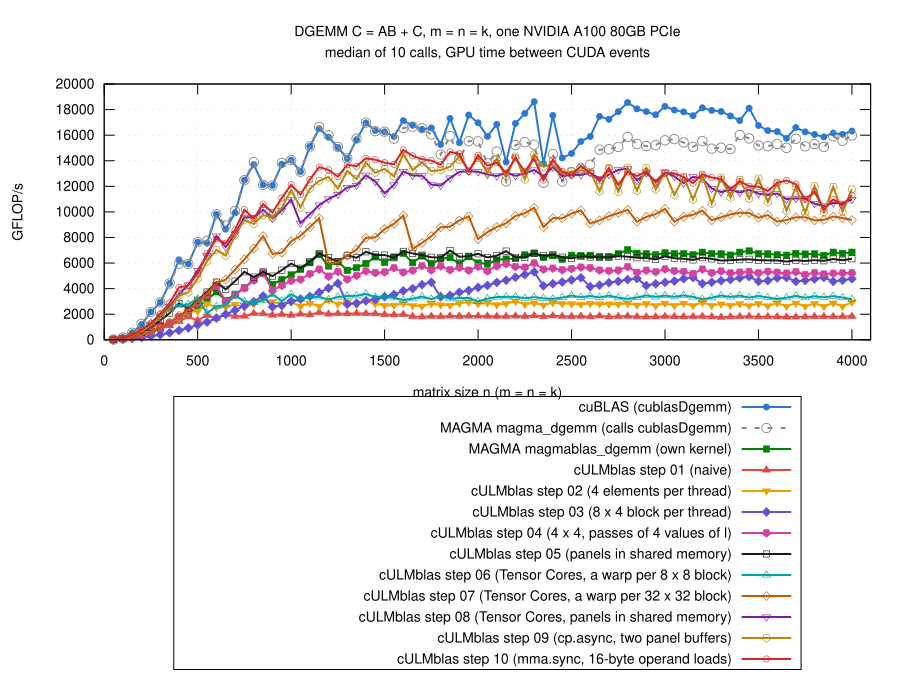

# Step 10: mma.sync, operands with 16-byte loads

## The idea

- Step 09, n = 2048: 208 M instructions for 33.5 M Tensor Core
  operations, cuBLAS 110 M.  Part of it: every WMMA fragment is its own
  8-byte load from shared memory (`load_matrix_sync`).
- Now the Tensor Core operation directly, `mma.sync.m8n8k4.f64` (inline
  PTX), whose operands per thread are documented (PTX ISA, "Matrix
  Fragments for mma.m8n8k4 with .f64"); lane = 4*g + tq (g = 0..7,
  tq = 0..3):

      the thread holds  A(g, tq), B(tq, g), C(g, 2*tq), C(g, 2*tq + 1)

  of the 8 x 4 block of A, the 4 x 8 block of B and the 8 x 8 block of C.
- Free to choose:
  - which values of l of a panel go into which of its Panel/4 operations
    (the sum over l in any order);
  - which rows and columns of C the 8 x 8 blocks of a warp cover.
- Chosen so that a thread needs pairs of neighbors in a column of a panel:
  one 16-byte load (`double2`, `LDS.128`) for two operands, half the
  loads of step 09.
- C directly from the registers into global memory, no detour through
  shared memory.
- The rest as in step 09 (cp.async, 2 buffers, 2 x 2 warps, 4 x 2 blocks
  of 8 x 8 per warp, panels of 16).
- Code: [gemm.cu](gemm.cu):

```cpp
__device__ inline void
mma884(double &c0, double &c1, double a, double b)
{
    asm volatile("mma.sync.aligned.m8n8k4.row.col.f64.f64.f64.f64 "
                 "{%0, %1}, {%2}, {%3}, {%0, %1};\n"
                 : "+d"(c0), "+d"(c1) : "d"(a), "d"(b));
}
...
//  a[r][s] = A(wi + 16*(r/2) + 2*g + r%2, l),
//  b[c][s] = B(l, wj + TilesN*g + c),  l = 8*(s/2) + 2*tq + s%2
double a[TilesM][S], b[TilesN][S];
for (int s = 0; s < S; ++s) {
    const int l = 8*(s/2) + 2*tq + s%2;
    for (int r = 0; r < TilesM; r += 2) {
        double2 v = *reinterpret_cast<const double2 *>(
            &sA[wi + 16*(r/2) + 2*g + l*LdA]);
        a[r][s] = v.x;
        a[r + 1][s] = v.y;
    }
}
for (int c = 0; c < TilesN; ++c) {
    for (int s = 0; s < S; s += 2) {
        double2 v = *reinterpret_cast<const double2 *>(
            &sB[8*(s/2) + 2*tq + (wj + TilesN*g + c)*LdB]);
        b[c][s] = v.x;
        b[c][s + 1] = v.y;
    }
}
for (int s = 0; s < S; ++s) {
    for (int r = 0; r < TilesM; ++r) {
        for (int c = 0; c < TilesN; ++c) {
            mma884(ab[r][c][0], ab[r][c][1], a[r][s], b[c][s]);
        }
    }
}
```

## First assignment: bank conflicts

- First try ([explore/gemm-first-assignment.cu](results/2026-10-29-a100/explore/gemm-first-assignment.cu)):
  - operation s uses l = 4*tq + s: a thread needs 4 neighboring values of
    l of a column of B;
  - block r of a warp covers rows wi + 4*g + r: a thread needs 4
    neighboring rows of a column of A.
- Quick test, round 1 ([explore/](results/2026-10-29-a100/explore/)),
  step 10 / step 09, n >= 1000:
  - columns padded by 4 doubles as in step 08: 0.80;
  - padded by 2 or 6 doubles: 0.98 to 0.99;
  - 15% fewer instructions than step 09, but not faster.
- Nsight Compute, n = 2048
  ([profile/first-assignment/](results/2026-10-29-a100/profile/first-assignment/)):

| n = 2048 | step 09 | first, padding 4 | first, padding 2 | second assignment |
|---|---:|---:|---:|---:|
| time (ms) | 1.43 | 1.80 | 1.49 | 1.41 |
| instructions | 208 M | 177 M | 177 M | 176 M |
| wavefronts of loads from shared memory | 51 M | 168 M | 101 M | 50 M |
| bank conflicts of these loads | 0.09 M | 118 M | 51 M | 0.14 M |
| Tensor Cores busy (%) | 83 | 65 | 80 | 84 |

- Why:
  - shared memory has 32 banks of 4 bytes; 16-byte loads of a warp are
    served for 8 threads at a time (8 x 16 = 128 bytes);
  - 8 threads: g = 0, 1 and tq = 0, ..., 3; conflict-free only if their
    8 addresses cover the 16 doubles of the banks once (mod 16);
  - first assignment, A: offsets 4*g + 4*tq*LdA (mod 16 doubles): g gives
    0 and 4, tq gives a multiple of 4 for every even LdA; two of the 8
    threads always hit the same banks, whatever the padding.

## Second assignment: conflict-free

- Pairs instead of quadruples:
  - operation s uses l = 8*(s/2) + 2*tq + s%2: a thread needs the pairs
    l = 2*tq, 2*tq + 1 and 8 + 2*tq, 9 + 2*tq;
  - block r covers rows wi + 16*(r/2) + 2*g + r%2: a thread needs the pairs
    of rows 2*g, 2*g + 1 and 16 + 2*g, 17 + 2*g.
- Offsets of the 8 threads (mod 16 doubles):
  - A: 2*g + 2*tq*LdA; with LdA = 64 + 2 (2 mod 8): g gives 0, 2, tq gives
    0, 4, 8, 12: all 8 different;
  - B: 2*tq + g*TilesN*LdB; with LdB = 16 + 4: tq gives 0, 2, 4, 6, g
    gives 0, 8: all 8 different.
- The kernel checks both with `static_assert`.
- Profile: last column of the table above
  ([profile/second-assignment/](results/2026-10-29-a100/profile/second-assignment/)).

## Blocks, panel, stages

- Quick test with the second assignment, round 3 (step 10 / step 09):

| variant | registers | n >= 1000 | n <= 500 |
|---|---:|---:|---:|
| **4 x 2 blocks per warp, panel 16, 2 stages** | **96** | **1.03** | **1.15 to 1.17** |
| C through shared memory instead of directly | 96 | 1.02 | 1.06 |
| panels of 8 | 82 | 0.96 | 1.11 |
| panels of 32 | 128 | 0.93 | 1.17 |
| 4 stages, panels of 8 | 72 | 1.01 | 1.08 |
| 2 x 2 blocks per warp | 72 | 0.96 | 1.55 |
| 2 x 4 blocks per warp | 96 | 0.97 | 1.17 |
| 4 x 4 blocks per warp | 160 | 0.94 | 0.82 |
| 4 x 4 blocks per warp, panels of 8 | 128 | 0.96 | 0.81 |

- The final code with all sizes against alternatives
  ([alternatives/](results/2026-10-29-a100/alternatives/), step 10 with the
  alternative / step 10 as it is):

| alternative | n <= 500 | n >= 1000 | n >= 2000 | n = 4000, TFLOP/s |
|---|---:|---:|---:|---:|
| as it is | 1 | 1 | 1 | 11.3 |
| 2 x 2 blocks per warp | 1.36 | 0.85 | 0.83 | 10.0 |
| 4 x 4 blocks per warp | 0.71 | 1.00 | 1.04 | 13.8 |
| 4 x 4 blocks per warp, panels of 8 | 0.70 | 1.03 | 1.06 | 14.1 |
| 4 stages, panels of 8 | 0.93 | 0.98 | 0.99 | 11.9 |

- 4 x 4 blocks per warp: 129 M instructions at n = 2048 (cuBLAS 110 M),
  but 160 registers, 3 blocks per SM; better from n = 2000 on, much worse
  for small matrices.

## Result



(From [results/2026-10-29-a100/bench-square.log](results/2026-10-29-a100/bench-square.log)
by [plot.gp](plot.gp), m = n = k = 50, 100, ..., 4000; all steps and the
references measured in the same job.)

- n >= 1000: 10.2 to 14.8 TFLOP/s
  - 1.03 times step 09 (median, 0.92 to 1.23), 1.05 times step 08;
  - 1.98 times MAGMA's own kernel;
  - 0.79 of cuBLAS (0.64 to 0.96).
- n > 2000: n = 2 mod 4: 1.06 times step 09; the other n: 0.99.
- n <= 500: 1.15 times step 09, 1.09 times step 08.
- `cULMblas::gemm` now uses step 10.
- Correctness: the 769 cases, all pass for steps 01 to 10 and
  `cULMblas::gemm` (8470 checks); compute-sanitizer finds no error
  ([check.log](results/2026-10-29-a100/check.log),
  [memcheck.log](results/2026-10-29-a100/memcheck.log)); after switching
  `cULMblas::gemm` to step 10 both again
  ([check-cULMblas/](results/2026-10-29-a100/check-cULMblas/)).

## What remains inefficient

- Profile at n = 2048 ([ncu-step10.log](results/2026-10-29-a100/ncu-step10.log)):
  - Tensor Cores busy 84% (cuBLAS 98%);
  - 176 M instructions (cuBLAS 110 M);
  - dominating stall "math pipe throttle" (153 k): the Tensor Cores are
    busy; then "wait" (68 k), waiting for global loads (36 k).
- Large matrices: 4 x 4 blocks per warp would be faster (14.1 TFLOP/s at
  n = 4000 against 11.3); small matrices: 2 x 2.  One kernel for all sizes
  is a compromise.
