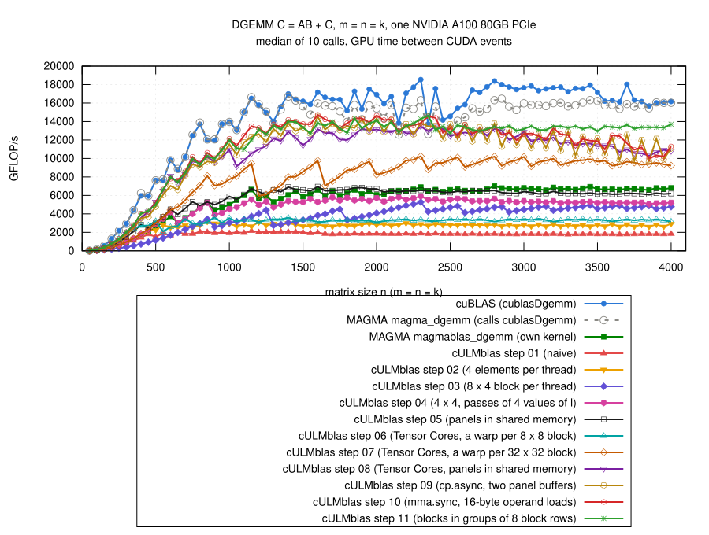

# Step 11: the order of the blocks

## Why steps 08 to 10 get slower for n >= 2000

- Step 10: 14.4 TFLOP/s at n = 2000, 13 at n = 3000, 11.3 at n = 4000;
  cuBLAS stays at 16 to 18.
- Nsight Compute (fixed clock 1.06 GHz): no drop, the kernel itself does
  not get worse
  ([why/profile-step10/](results/2026-10-29-a100/why/profile-step10/)):

| n | time (ms) | TFLOP/s at 1.06 GHz | L2 hit rate (%) | read from DRAM | DRAM throughput (%) |
|---:|---:|---:|---:|---:|---:|
| 1600 | 0.70 | 11.7 | 89 | 0.16 GB | 13 |
| 2048 | 1.41 | 12.2 | 82 | 0.59 GB | 23 |
| 3000 | 4.38 | 12.3 | 72 | 3.6 GB | 43 |
| 4000 | 10.11 | 12.7 | 65 | 11.7 GB | 61 |

- In the benchmark the clock is not fixed: the A100 PCIe has a power
  limit of 300 W.  `nvidia-smi` every 100 ms during 100 calls
  ([why/clocks/](results/2026-10-29-a100/why/clocks/)), n = 4000:

| | SM clock under load | power | throttle reason | TFLOP/s |
|---|---:|---:|---|---:|
| cuBLAS | 1215 to 1230 MHz | ~300 W | power cap | 16.3 |
| step 10 | ~1020 MHz | ~300 W | power cap | 12.2 |

  - maximum clock 1410 MHz; both run into the power limit;
  - 12.7 TFLOP/s at 1.06 GHz is 12.2 at 1.02 GHz: the drop is the clock.
- Why step 10 gets less clock: DRAM traffic, which costs energy, grows
  much faster than the work (table above):
  - blocks start with `blockIdx.x` running fastest: ~540 blocks at the
    same time cover all 63 block rows of C but only ~9 block columns;
  - each such group of block columns reads all of A;
  - from n ~ 2000 on A (32 MB at n = 2000, 128 MB at n = 4000) does not
    fit into the 40 MB L2 cache, and is read from DRAM again and again.

## The idea

- The blocks running at the same time should cover a region of C closer to
  a square: they share their panels of A and B in the L2 cache.
- Number the blocks in the order they are started,
  id = blockIdx.x + blockIdx.y*gridDim.x, and map id to a block of C group
  by group: Group block rows (fewer for the last group), within the group
  column by column.  CUTLASS calls this "threadblock swizzle".
- Group = 8: 540 blocks at the same time cover 8 block rows and ~68 block
  columns of C.
- Code: [gemm.cu](gemm.cu), only the first lines of the kernel change:

```cpp
const unsigned numBlocksM = gridDim.x, numBlocksN = gridDim.y;
const unsigned id = blockIdx.x + blockIdx.y*numBlocksM;
const unsigned first = id/(Group*numBlocksN)*Group;
const unsigned rows = numBlocksM - first < Group ? numBlocksM - first
                                                 : Group;
const unsigned inGroup = id - first*numBlocksN;
const std::ptrdiff_t i0 = std::ptrdiff_t(first + inGroup % rows)*BlockRows;
const std::ptrdiff_t j0 = std::ptrdiff_t(inGroup / rows)*BlockCols;
```

- 32-bit arithmetic; the host function checks that the number of blocks
  fits.

## How many block rows per group

- n = 4000, Nsight Compute (DRAM, L2 at fixed clock) and the benchmark with
  100 calls while `nvidia-smi` logs the clock
  ([groups/profile/](results/2026-10-29-a100/groups/profile/)):

| block rows per group | read from DRAM | L2 hit rate (%) | mean clock under load | TFLOP/s |
|---:|---:|---:|---:|---:|
| step 10 (block columns) | 10.3 GB | 67 | – | – |
| 1 (block rows one by one) | 8.35 GB | 72 | 1111 MHz | 12.6 |
| 4 | 2.93 GB | 87 | 1178 MHz | 13.7 |
| **8** | **2.42 GB** | **89** | **1185 MHz** | **13.7** |
| 16 | 3.03 GB | 86 | 1177 MHz | 13.4 |

- Large sizes, TFLOP/s ([groups/large/](results/2026-10-29-a100/groups/large/),
  each group size in its own build, step 11 measured after step 10):

| block rows per group | n = 2000 | 2500 | 3000 | 3500 | 4000 |
|---:|---:|---:|---:|---:|---:|
| 1 | 14.6 | 12.7 | 13.4 | 12.9 | 12.8 |
| 2 | 14.1 | 13.6 | 13.7 | 13.2 | 13.7 |
| 4 | 14.1 | 12.8 | 13.6 | 13.7 | 14.0 |
| 8 | 14.4 | 13.2 | 13.5 | 13.7 | 14.0 |
| 16 | 14.4 | 13.2 | 13.2 | 13.8 | 13.8 |
| 32 | 14.2 | 13.8 | 13.9 | 13.4 | 13.6 |

- 4 to 16 about the same; 8 is the default (`-DCULMBLAS_STEP11_GROUP=...`).
- n <= 2000: no difference ([groups/quick/](results/2026-10-29-a100/groups/quick/)).

## The order of the measurements matters

- First measurements: step 11 at n = 2500 and 3000 0.90 and 0.95 of step 10.
- In these runs step 11 was always measured right after step 10, on a GPU
  that had just been under full load.
- With step 11 measured first ([order/swap/](results/2026-10-29-a100/order/swap/),
  two runs), step 11 / step 10:

| n | 2000 | 2500 | 3000 | 3500 | 4000 |
|---|---:|---:|---:|---:|---:|
| run 1 | 1.07 | 0.97 | 1.09 | 1.04 | 1.15 |
| run 2 | 1.02 | 0.98 | 1.07 | 1.13 | 1.18 |

- At fixed clock ([order/profile/](results/2026-10-29-a100/order/profile/)):
  same time at n = 2500 (2.66 ms) and 3000 (4.44 / 4.39 ms); DRAM 1.48 GB
  -> 0.51 GB at 2500, 4.85 GB -> 0.84 GB at 3000.
- So the gain is the clock, and differences of a few percent between runs
  are within what the power management does; small differences in the
  tables of all steps should be read with that in mind.

## Result



(From [results/2026-10-29-a100/bench-square.log](results/2026-10-29-a100/bench-square.log)
by [plot.gp](plot.gp), m = n = k = 50, 100, ..., 4000; all steps and the
references measured in the same job.)

- n >= 3000: 1.09 times step 10 (median, 1.02 to 1.34), 0.77 of cuBLAS,
  2.00 times MAGMA's own kernel; n = 4000: 13.7 TFLOP/s (step 10: 11.3).
- n >= 1000: 11.0 to 14.6 TFLOP/s, 0.82 of cuBLAS.
- n <= 2000: as fast as step 10 (0.99 to 1.00).
- `cULMblas::gemm` now uses step 11.
- Correctness: the 769 cases, all pass for steps 01 to 11 and
  `cULMblas::gemm` (9240 checks); compute-sanitizer finds no error
  ([check.log](results/2026-10-29-a100/check.log),
  [memcheck.log](results/2026-10-29-a100/memcheck.log)); after switching
  `cULMblas::gemm` to step 11 both again
  ([check-cULMblas/](results/2026-10-29-a100/check-cULMblas/)).
- A first version computed the order of the blocks with 64-bit integers
  ([validation-64bit-index/](results/2026-10-29-a100/validation-64bit-index/)),
  same results.

## What remains inefficient

- Step 11 executes more instructions than step 10: n = 1000 25.3 M against
  22.6 M, n = 4000 1484 M against 1318 M
  ([order/profile-instructions/](results/2026-10-29-a100/order/profile-instructions/));
  not from the division of the block numbers (the same with 64 and with 32
  bits), not looked into.  At fixed clock 2% slower at n = 1000, equal at
  n = 4000.
- The power limit: cuBLAS gets a higher clock (1215 to 1230 MHz at
  n = 4000) and does more per cycle.
- One block shape for all sizes: 2 x 2 blocks of 8 x 8 per warp would be
  better for small matrices, 4 x 4 for large ones (step 10).
