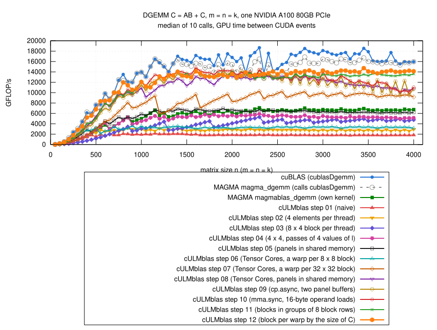

# Step 12: the block per warp by the size of C

## The idea

- Steps 10 and 11 have one kernel for all sizes: 4 x 2 blocks of 8 x 8
  elements of C per warp, 64 x 32 elements per block of threads.
- The measurements of the alternatives (steps 08 to 11):
  - 2 x 2 blocks per warp (32 x 16 per block): more blocks of threads,
    better for small matrices;
  - 4 x 4 blocks per warp (64 x 64 per block): fewer instructions per
    `mma.sync`, better for large matrices.
- Now three kernels, `gemm` chooses one by the size of C.
- Code: [gemm.cu](gemm.cu):
  - the kernel of step 11 is a template over a `Shape`
    (TilesM x TilesN blocks of 8 x 8 per warp, Panel values of l); all
    constants that depend on it, and the `static_assert`s for the 16-byte
    accesses without bank conflicts, are members of `Shape`;
  - `launch<Shape>` does what `gemm` did in step 11;
  - `gemm` chooses:

```cpp
using ShapeSmall  = Shape<2, 2, 16>;    // 32 x 16 elements of C per block
using ShapeMedium = Shape<4, 2, 16>;    // 64 x 32, as in step 11
using ShapeLarge  = Shape<4, 4, 8>;     // 64 x 64
...
if (m*n < 1000*1000) {
    launch<ShapeSmall>(m, n, k, alpha, A, ldA, B, ldB, beta, C, ldC, stream);
} else if (m*n < 3000*3000) {
    launch<ShapeMedium>(m, n, k, alpha, A, ldA, B, ldB, beta, C, ldC, stream);
} else {
    launch<ShapeLarge>(m, n, k, alpha, A, ldA, B, ldB, beta, C, ldC, stream);
}
```

- New test case `3001 x 3003 x 515` (770 cases from this step on): before
  it, the only case with m*n >= 3000*3000 was `3000 x 3000 x 1`.

## The thresholds

- The kernel of step 11 with the other blocks per warp
  (`-DCULMBLAS_STEP11_TILES_M=...` etc.), all sizes
  ([shapes/](results/2026-10-29-a100/shapes/)); medians of the ratio to
  4 x 2:

| blocks per warp, panel | n <= 500 | n = 550 to 950 | n = 1000 to 1950 | n = 2000 to 2950 | n >= 3000 |
|---|---:|---:|---:|---:|---:|
| 2 x 2, 16 | **1.33** | **1.10** | 0.91 | 0.91 | 0.89 |
| 2 x 2, 8 | 1.16 | 1.06 | 0.81 | 0.82 | 0.87 |
| 2 x 4, 16 | 1.00 | 1.01 | 1.01 | 1.02 | 1.02 |
| 4 x 2, 16 | 1 | 1 | 1 | 1 | 1 |
| 4 x 4, 16 | 0.71 | 0.81 | 0.97 | 0.99 | 1.06 |
| 4 x 4, 8 | 0.69 | 0.86 | 0.97 | 1.01 | **1.07** |

- 2 x 2 up to n ~ 950, 4 x 4 from n ~ 3000 on; for rectangular matrices
  by m*n (the number of blocks of threads), not by k.

## Result



(From [results/2026-10-29-a100/bench-square.log](results/2026-10-29-a100/bench-square.log)
by [plot.gp](plot.gp), m = n = k = 50, 100, ..., 4000; all steps and the
references measured in the same job.)

| n | step 12 / step 11 (median, range) | step 12 / cuBLAS (median, range) |
|---|---:|---:|
| <= 500 | 1.33 (1.15 to 1.43) | 0.88 (0.76 to 1.05) |
| 550 to 950 | 1.11 | 0.89 (0.78 to 1.08) |
| 1000 to 2950 | 1.00 (0.96 to 1.11) | 0.81 (0.72 to 1.01) |
| >= 3000 | 1.06 (1.00 to 1.09) | 0.81 (0.78 to 0.90) |
| all | 1.05 | 0.82 (0.72 to 1.08) |

- Up to 14.7 TFLOP/s (n = 3450); 2.14 times MAGMA's own kernel (median).
- Faster than cuBLAS at n = 50, 550 and 2150.
- `cULMblas::gemm` now uses step 12.
- Correctness: the 770 cases, all pass for steps 01 to 12 and
  `cULMblas::gemm` (10023 checks); compute-sanitizer finds no error
  ([check.log](results/2026-10-29-a100/check.log),
  [memcheck.log](results/2026-10-29-a100/memcheck.log)); after switching
  `cULMblas::gemm` to step 12 both again
  ([check-cULMblas/](results/2026-10-29-a100/check-cULMblas/)).

## Rectangular matrices

- 12 shapes, two runs each, step 12 measured before step 11
  ([rect-step12-first/](results/2026-10-29-a100/rect-step12-first/)):

| m x n x k | kernel | step 12, TFLOP/s | step 12 / step 11 | step 12 / cuBLAS |
|---|---|---:|---:|---:|
| 4000 x 4000 x 256 | large | 13.1 | 1.01 | 0.80 |
| 4000 x 256 x 4000 | medium | 13.2 | 1.00 | 0.74 |
| 256 x 4000 x 4000 | medium | 13.5 | 1.00 | 0.81 |
| 8000 x 1000 x 2000 | medium | 15.5 | 1.10 | 0.93 to 0.94 |
| 1000 x 8000 x 2000 | medium | 14.4 to 15.3 | 0.98 to 1.11 | 0.81 to 0.86 |
| 2000 x 2000 x 8000 | medium | 13.5 | 1.02 to 1.03 | 0.75 to 0.77 |
| 6000 x 2000 x 2000 | large | 14.8 to 15.6 | 1.01 to 1.05 | 0.81 to 0.85 |
| 2000 x 6000 x 2000 | large | 14.8 to 15.2 | 1.01 to 1.04 | 0.86 to 0.88 |
| 3000 x 3000 x 3000 | large | 14.4 to 14.7 | 1.01 to 1.03 | 0.80 to 0.82 |
| 1000 x 1000 x 8000 | medium | 12.9 to 13.0 | 1.03 to 1.04 | 0.82 to 0.83 |
| 500 x 500 x 4000 | small | 8.7 | 1.40 | 0.82 |
| 8000 x 8000 x 500 | large | 14.5 to 14.6 | 1.03 to 1.05 | 0.83 |

## The order of the measurements, again

- First run of the rectangular shapes with step 11 measured before step 12
  ([rect/](results/2026-10-29-a100/rect/)): 8000 x 1000 x 2000 0.89,
  1000 x 1000 x 8000 0.93 of step 11, in both runs.
- But for both shapes step 12 uses the same kernel as step 11 (4 x 2).
- With step 12 measured first: 1.10 and 1.03.
- So whichever is measured second loses up to ~10% for these long calls:
  the GPU comes from full load, the power management has lowered the
  clock (see [step 11](../step11/README.md)).
- Consequence for all steps: differences of a few percent between
  implementations measured one after the other in the same job are not
  reliable; the larger differences of the steps are.

## What remains inefficient

- 81% of cuBLAS for n >= 1000:
  - instructions: n = 2048 (medium kernel) 199 M for 33.5 M `mma.sync`,
    5.9 per operation (cuBLAS 3.3,
    [ncu-step12.log](results/2026-10-29-a100/ncu-step12.log));
  - Tensor Cores busy 85% of the time (cuBLAS 98%);
  - the clock under the power limit (n = 4000: step 11 ~1185 MHz, cuBLAS
    ~1220 MHz).
- The thresholds are for this GPU, from square matrices.
