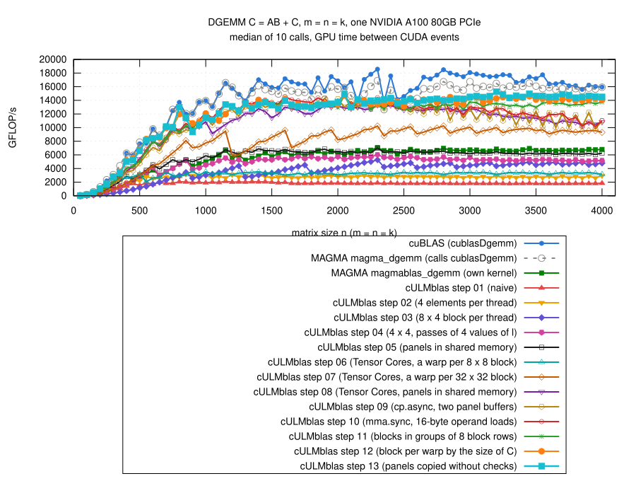

# Step 13: the panels copied without checks

## The idea

- Step 12, n = 2048 (medium kernel): 199 M instructions for 33.5 M
  `mma.sync`, 5.9 per operation; cuBLAS 3.3.
- Where they are, in the machine code of the loop over the panels
  ([../step12/results/2026-10-29-a100/sass-step12.txt](../step12/results/2026-10-29-a100/sass-step12.txt)):
  - 32 `DMMA`, 12 `LDS.128`, ~15 instructions for addresses in shared
    memory: ~60;
  - the copies of the next panel: 6 `LDGSTS` (cp.async), each with a check
    whether the pair is inside of A or B, branches, and a 64-bit address
    computed from i, l, ldA: ~120 executed;
  - so most of the instructions are for the copies, not for the Tensor
    Cores.
- No check is needed if the block of threads is inside of C
  (mb == BlockRows, nb == BlockCols) and the panel is full (all panels but
  the last if Panel does not divide k).
- Then:
  - before the loop, every thread computes the address of its first pair
    of A and of B (`pA`, `pB`) and its offsets in the buffers;
  - copy q of a thread is q*StepA columns of A (q*StepB columns of B)
    further: in shared memory a constant offset, in A and B
    q*StepA*ldA;
  - after a panel `pA += Panel*ldA`, `pB += Panel`.
- The other blocks and the last panel: the copies with checks of step 12.
- Code: [gemm.cu](gemm.cu):

```cpp
const std::ptrdiff_t numFast = Vec && mb == BlockRows && nb == BlockCols
                               ? k/Panel : 0;
const int iA = 2*tid % BlockRows, lA = 2*tid / BlockRows;
const int lB = 2*tid % Panel, jB = 2*tid / Panel;
const int sOffA = iA + lA*LdA, sOffB = lB + jB*LdB;
...
const double *pA = A + iA + lA*std::ptrdiff_t(ldA);
const double *pB = B + lB + jB*std::ptrdiff_t(ldB);

auto copyPanel = [&](std::ptrdiff_t t) {
    if (t < numFast) {
        double *sA = buf + (t % Stages)*SizeStage, *sB = sA + SizeA;
        for (int q = 0; q < CopiesA; ++q) {
            __pipeline_memcpy_async(&sA[sOffA + q*StepA*LdA],
                                    pA + q*stepA, 16);
        }
        for (int q = 0; q < CopiesB; ++q) {
            __pipeline_memcpy_async(&sB[sOffB + q*StepB*LdB],
                                    pB + q*stepB, 16);
        }
        pA += nextA;
        pB += Panel;
    } else if (t < numPanels) {
        ...     // as in step 12
    }
    __pipeline_commit();
};
```

- Machine code, medium kernel: the copies of a panel 29 instructions
  instead of ~120, the whole loop ~100 for 32 `DMMA`
  ([sass-step13.txt](results/2026-10-29-a100/sass-step13.txt)).

## Variants

- 7 jobs, step 13 with switches against step 12 (the kernel with the
  switches: [explore/gemm-knobs.cu](results/2026-10-29-a100/explore/gemm-knobs.cu);
  q*: m = n = k = 50, 100, 150, 200, 300, ..., 2000, f*: 50, 100, ..., 4000;
  [explore/](results/2026-10-29-a100/explore/)).
- Medians of step 13 / step 12, step 13 measured first:

| variant | registers (S, M, L) | n <= 500 | 550 to 950 | 1000 to 1950 | 2000 to 2950 | n >= 3000 |
|---|---|---:|---:|---:|---:|---:|
| as step 12 (no copies without checks) | 66, 94, 125 | 1.00 | 1.00 | 1.00 | 1.03 to 1.04 | 0.99 |
| offsets of every copy in arrays | 62, 94, 121 | 0.96 | 1.02 | 1.01 | 1.01 | – |
| **pointers, constant offsets** | **66, 98, 128** | **0.96 to 1.00** | **1.01 to 1.02** | **1.00 to 1.01** | **1.02 to 1.03** | **1.03** |
| ... loop over the panels unrolled twice | 78, 98, 134 | 0.96 to 0.97 | 1.00 to 1.02 | 1.00 to 1.01 | 1.01 to 1.05 | 0.99 |
| small kernel with panels of 8 | 56, 98, 128 | 0.88 | 1.00 | 1.00 | 1.01 | – |
| medium kernel with panels of 32 | 66, 156, 128 | 1.00 | 1.01 | 0.95 | 0.96 | – |
| medium kernel 2 x 4 instead of 4 x 2 | 66, 102, 128 | 1.00 | 1.02 | 0.96 | 1.00 | – |
| large kernel with panels of 16 | 66, 98, 168 | 0.97 | 1.01 | 1.00 | 1.05 | 0.95 |
| small kernel up to m*n < 700^2 / 1300^2 | | 0.97 / 0.95 | 0.88 / 1.01 | 1.00 | 1.03 to 1.06 | – |
| large kernel from 2000^2 / 2500^2 | | 0.96 to 0.98 | 1.00 to 1.01 | 1.01 | 0.99 to 1.04 | 1.02 |

- The first row is step 12 with another name: 1.03 to 1.04 for
  n = 2000 to 2950 is only the order of the measurements (step 13
  before step 12).  Differences of a few percent in this table are not reliable.
- None of the other variants is clearly better; thresholds and shapes stay
  as in step 12.

## Fewer instructions, hardly faster

- Nsight Compute at fixed clock (1.06 GHz;
  [ncu-step13-*.log, ncu-step12-*.log](results/2026-10-29-a100/)):

| n (kernel) | | time | instructions | per `mma.sync` | issue slots used (%) | Tensor Cores busy (%) |
|---|---|---:|---:|---:|---:|---:|
| 256 (small) | step 12 | 22.2 us | 0.61 M | 4.7 | 12.0 | 20.2 |
| | step 13 | 21.3 us | 0.38 M | 2.9 | 7.7 | 20.9 |
| 512 (small) | step 12 | 46.2 us | 4.60 M | 4.4 | 25.1 | 45.5 |
| | step 13 | 43.1 us | 2.71 M | 2.6 | 16.8 | 51.4 |
| 2048 (medium) | step 12 | 1.41 ms | 199 M | 5.9 | 31.4 | 84.9 |
| | step 13 | 1.37 ms | 106 M | 3.2 | 17.1 | 86.5 |
| 4000 (large) | step 12 | 10.09 ms | 1277 M | 5.0 | 28.1 | 89.6 |
| | step 13 | 10.02 ms | 746 M | 2.9 | 17.0 | 92.7 |

- Instructions per `mma.sync` now as in cuBLAS (3.3).
- But only 1 to 7% faster at fixed clock: the instructions were not what
  limited step 12.  The issue slots were used only 30% of the time; the
  warps wait for the Tensor Cores ("math pipe throttle"), at the barrier
  and for the copies.
- A first profile ([profile/](results/2026-10-29-a100/profile/)): 1.39 ->
  1.37 ms at n = 2048, 10.03 -> 9.82 ms at n = 4000.

## Result



(From [results/2026-10-29-a100/bench-square.log](results/2026-10-29-a100/bench-square.log)
by [plot.gp](plot.gp), m = n = k = 50, 100, ..., 4000; all steps and the
references measured in the same job, step 13 after step 12.)

| n | step 13 / step 12 (median, range) | step 13 / cuBLAS (median, range) |
|---|---:|---:|
| <= 500 | 0.96 (0.92 to 1.05) | 0.88 (0.78 to 1.26) |
| 550 to 950 | 1.00 (0.88 to 1.08) | 0.95 (0.76 to 1.05) |
| 1000 to 2950 | 1.00 (0.95 to 1.12) | 0.81 (0.75 to 1.03) |
| >= 3000 | 1.03 (1.00 to 1.07) | 0.87 (0.80 to 0.93) |
| all | 1.01 | 0.84 (0.75 to 1.26) |

- Up to 15.3 TFLOP/s (n = 3200); n = 4000: 14.5 (step 12: 14.0).
- Faster than cuBLAS at n = 50, 350, 550, 2150, 2350.
- n >= 3000 a bit faster than at fixed clock; probably fewer instructions,
  less power, a bit more clock under the power limit (see step 11), not
  measured.
- n <= 500: 0.96 of step 12 in all runs, also with step 13 measured first,
  although at fixed clock step 13 is faster (n = 256, 512); not explained.
- `cULMblas::gemm` now uses step 13.
- Correctness: the 770 cases, all pass for steps 01 to 13 and
  `cULMblas::gemm` (10794 checks); compute-sanitizer finds no error
  ([check.log](results/2026-10-29-a100/check.log),
  [memcheck.log](results/2026-10-29-a100/memcheck.log)); this job already
  with `cULMblas::gemm` switched to step 13.

## What remains inefficient

- Tensor Cores busy 86% (n = 2048) and 93% (n = 4000), cuBLAS 98%.
- The warps wait at the `__syncthreads()` of every panel and for the
  copies: 2 buffers (step 09: more buffers cost blocks per SM).
- Small matrices: 0.88 of cuBLAS for n <= 500.
