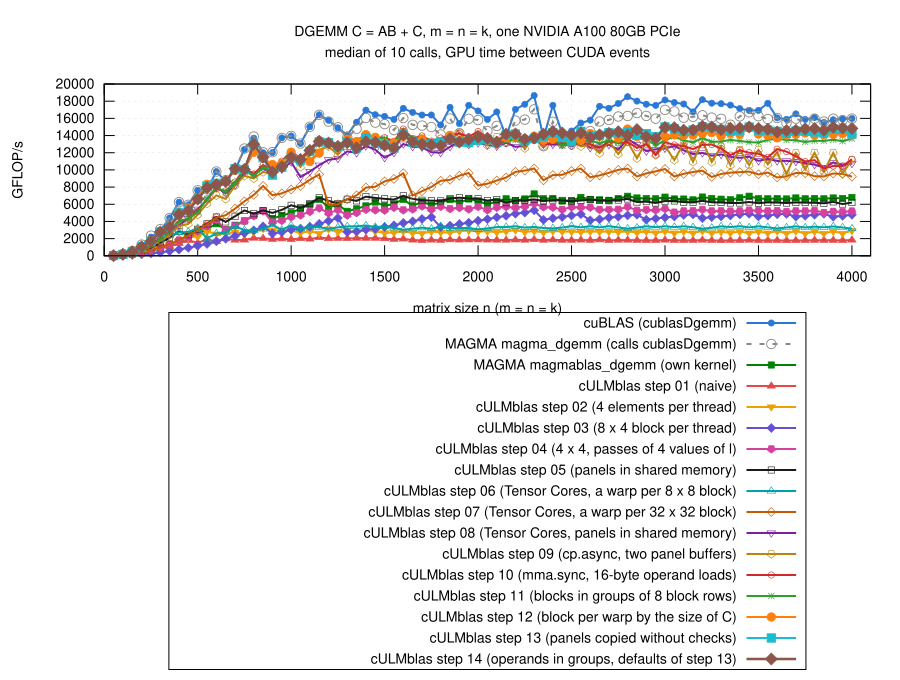

# Step 14: more Tensor Core work between two barriers?

This step is an experiment that did not make the kernel faster.  I keep it
because the measurements explain what limits step 13, and what does not.

## What is inefficient in step 13

- Step 13 reaches 84% of cuBLAS (median over all sizes).  Instructions per
  `mma.sync` are already as low as in cuBLAS.
- Step 13 against cuBLAS with Nsight Compute (`--set full`, fixed clock
  1.06 GHz, third call of each;
  [profile-step13/](results/2026-10-29-a100/profile-step13/)):

| n | | time | Tensor Cores busy (%) | blocks per SM (limit) | warps active (%) | waves |
|---:|---|---:|---:|---|---:|---:|
| 1024 | cuBLAS | 173 us | 92.2 | 3 (shared memory) | 16.8 | 1.6 |
| | step 13 | 207 us | 77.9 | 4 (registers) | 20.8 | 1.2 |
| 2048 | cuBLAS | 1.26 ms | 98.1 | 2 (shared memory) | 12.1 | 4.7 |
| | step 13 | 1.37 ms | 86.4 | 4 (registers) | 23.6 | 4.7 |
| 4000 | cuBLAS | 8.97 ms | 99.2 | 2 (shared memory) | 12.4 | 18.7 |
| | step 13 | 9.77 ms | 92.7 | 4 (registers) | 23.7 | 9.2 |

- cuBLAS uses CUTLASS kernels (`cutlass_80_tensorop_d884gemm_64x64_16x4`
  for n >= 2048, `64x32_16x4` at 1024, `32x32_16x5` at 512): blocks of
  64 x 64 elements of C, panels of 16 values of l, 4 (or 5) panel buffers.
- cuBLAS keeps the Tensor Cores busier with half as many warps.  So
  occupancy is not the problem.

## What the profiler shows

- Where the warps of step 13 wait (samples of the warp states per
  instruction, n = 2048, medium kernel):

| where | reason | step 13 | cuBLAS |
|---|---|---:|---:|
| the `DMMA` (Tensor Cores busy with other warps) | math pipe throttle | 38% | 40% |
| fixed latencies between instructions | wait | 17% | 43% |
| after `BAR.SYNC` (`__syncthreads()`) | barrier | 12.5% | 1.4% |
| after `DEPBAR` (`__pipeline_wait_prior`, the copies of the next panel) | long scoreboard | ~8% | 0.6% |
| `LDS` (shared memory) | mio throttle | 6% | 0.2% |

- So a warp of step 13 waits about a fifth of its time for the next panel
  or for the other warps of its block.
- Checked, and not the problem:
  - the last wave: at n = 4000 the SMs are busy 0.978 (step 13) and 0.993
    (cuBLAS) of the time of the busiest SM, about 1.5 of the 9% between
    the two;
  - the clock: alone on the GPU for ~3 s, both run into the power limit
    of 300 W, step 13 at 1185 to 1290 MHz, cuBLAS at 1200 to 1230 MHz
    (`nvidia-smi` every 50 ms, [clockrun.cu](results/2026-10-29-a100/profile-step13/clockrun.cu));
    with 10 s between the runs no order effect;
  - shared memory: 0.3% bank conflicts, 25 to 34% of its throughput;
  - the instructions: 3.2 per `mma.sync` (cuBLAS 3.3).
- Not measured, a hypothesis: the L2 cache is busier with step 13 (58 to
  61% of its throughput, cuBLAS 33 to 35%, smaller blocks of C at
  n = 2048), so the copies may take longer.

## Experiment 1: more panel buffers

- Idea: with 2 buffers only the next panel is on the way while a panel is
  computed.  With 3 or 4 buffers the copies have more time.
- Code ([gemm.cu](gemm.cu)): `Stages` is now a parameter of each of the
  three kernels (`CULMBLAS_STEP14_STAGES_SMALL`, `..._MEDIUM`, `..._LARGE`).
  The buffer of a panel is counted instead of computed as `t % Stages`
  (step 09: `t % 3` costs instructions):

```cpp
int bufRead = 0, bufWrite = Stages - 1;
for (std::ptrdiff_t t = 0; t < numPanels; ++t) {
    __pipeline_wait_prior(Stages - 2);
    __syncthreads();
    copyPanel(t + Stages - 1, bufWrite);
    const double *sA = buf + bufRead*SizeStage, *sB = sA + SizeA;
    ...
    bufWrite = bufRead;
    bufRead = bufRead + 1 == Stages ? 0 : bufRead + 1;
}
```

- Nsight Compute, fixed clock
  ([profile-stages/](results/2026-10-29-a100/profile-stages/)):

| n | buffers | time | Tensor Cores busy (%) | blocks per SM | barrier | after `DEPBAR` |
|---:|---:|---:|---:|---:|---:|---:|
| 2048 | 2 | 1.392 ms | 85.7 | 4 | 13.4% | 11.5% |
| | 3 | 1.355 ms | 87.4 | 4 | 17.0% | 6.5% |
| | 4 | 1.424 ms | 83.2 | 3 | 11.2% | 7.2% |
| 4000 | 2 | 9.79 ms | 92.8 | 4 | 21.1% | 3.1% |
| | 3 | 9.67 ms | 93.2 | 4 | 17.4% | 2.7% |
| | 4 | 9.99 ms | 92.7 | 4 | 3.8% | 4.1% |

  - with 3 buffers the warps wait less for the copies, but more at the
    barrier: 1 to 3% faster at fixed clock;
  - with 4 buffers the medium kernel needs 55 KB of shared memory per
    block, 3 blocks per SM: slower.
- Benchmark, step 14 / step 13, step 14 measured first
  ([stages/](results/2026-10-29-a100/stages/)):

| buffers | n <= 500 | 550 to 950 | 1000 to 1950 | 2000 to 2950 | n >= 3000 |
|---|---:|---:|---:|---:|---:|
| 2 (as step 13) | 1.00 | 1.00 | 1.00 | 1.02 to 1.05 | 1.01 |
| 3 | 1.00 | 0.97 to 0.98 | 1.01 | 1.02 to 1.03 | 1.01 |
| 4 | 1.00 | 0.96 to 0.97 | 0.96 to 0.97 | 0.98 to 1.02 | 0.98 |
| 3, medium and large kernel only | 1.00 | 1.00 | 1.01 | 1.06 | 1.02 |
| 3 with `t % 3` | 0.97 | 0.96 | 0.97 | 0.97 | – |

- The first row computes the same as step 13: its 1.02 to 1.05 is the
  order of the measurements.  3 buffers are not reproducibly better.
- The barrier: at n = 4000 its share goes from 21% to 4%, and the Tensor
  Cores stay at 93%.  A warp waiting at the barrier costs nothing as long
  as the warps of the other blocks keep the Tensor Cores busy.

## Experiment 2: longer panels, operands in groups

- Idea: a cuBLAS warp does 64 `mma.sync` between two barriers (32 x 32
  elements of C, panels of 16), a warp of step 13 32 (panels of 16 in
  the medium kernel, of 8 in the large one).  Longer panels mean fewer
  barriers and waits per `mma.sync`.
- Earlier attempts (steps 08 to 13) with longer panels needed many more
  registers: a warp loads the operands of the whole panel into registers
  before it computes (`a[TilesM][Panel/4]`, `b[TilesN][Panel/4]`).
- Change: the panel in groups of 8 values of l.  A warp loads the
  operands of one group, does its 2*TilesM*TilesN `mma.sync`, then loads
  the next group.  The panel in shared memory can be longer than what is
  in the registers.  Same order of the summation as in step 13:

```cpp
#pragma unroll
for (int j = 0; j < Panel/8; ++j) {
    double a[TilesM][2], b[TilesN][2];
    for (int h = 0; h < 2; ++h) {
        const int l = 8*j + 2*tq + h;
        for (int r = 0; r < TilesM; r += 2) {
            double2 v = *reinterpret_cast<const double2 *>(
                &sA[wi + 16*(r/2) + 2*g + l*LdA]);
            a[r][h] = v.x;
            a[r + 1][h] = v.y;
        }
    }
    for (int c = 0; c < TilesN; ++c) {
        double2 v = *reinterpret_cast<const double2 *>(
            &sB[8*j + 2*tq + (wj + TilesN*g + c)*LdB]);
        b[c][0] = v.x;
        b[c][1] = v.y;
    }
    for (int h = 0; h < 2; ++h) {
        for (int r = 0; r < TilesM; ++r) {
            for (int c = 0; c < TilesN; ++c) {
                mma884(ab[r][c][0], ab[r][c][1], a[r][h], b[c][h]);
            }
        }
    }
}
```

- Registers (16-byte copies):

| kernel, panel | step 13 | groups | groups, at most 128 (4 blocks per SM) |
|---|---:|---:|---:|
| medium (4 x 2), 16 | 100 | 100 | – |
| medium (4 x 2), 32 | 158 | 128 | 128 |
| large (4 x 4), 8 | 128 | 128 | – |
| large (4 x 4), 16 | 166 | 156 | 128 (24 bytes spilled) |

  - the compiler still loads operands of the next group early (it hides
    the latency of `LDS`), so the large kernel needs the bound to stay at
    128;
  - `CULMBLAS_STEP14_PANEL_SMALL`, `..._MEDIUM`, `..._LARGE` set the
    panels, `CULMBLAS_STEP14_MIN_BLOCKS` the bound.
- But longer panels also need more shared memory: medium kernel, panels
  of 32, 2 buffers: 52 KB, 3 blocks per SM.
- Nsight Compute, fixed clock
  ([profile-groups/](results/2026-10-29-a100/profile-groups/)):

| n (kernel) | variant | time | Tensor Cores busy (%) | registers | blocks per SM | barrier | after `DEPBAR` |
|---|---|---:|---:|---:|---:|---:|---:|
| 2048 (medium) | panel 16 (step 13) | 1.376 ms | 85.6 | 100 | 4 | 13.3% | 11.9% |
| | panel 32 | 1.466 ms | 81.0 | 128 | 3 | 11.8% | 14.3% |
| 4000 (large) | panel 8 (step 13) | 9.71 ms | 92.8 | 128 | 4 | 21.3% | 3.1% |
| | panel 16, at most 128 registers | 9.93 ms | 90.3 | 128 | 4 | 17.3% | 8.4% |

  - medium kernel: one block per SM less, slower;
  - large kernel: fewer barriers, but the copies of a panel twice as
    long; with 2 buffers the warps wait longer for them.
- Benchmark, step 14 / step 13, step 14 measured first
  ([groups-fixed/](results/2026-10-29-a100/groups-fixed/)):

| variant | n <= 500 | 550 to 950 | 1000 to 1950 | 2000 to 2950 | n >= 3000 |
|---|---:|---:|---:|---:|---:|
| defaults (= step 13) | 1.00 | 1.00 | 1.00 | 1.02 | 1.01 |
| medium panel 32 | 1.00 | 1.00 | 0.95 | 0.96 | 1.01 |
| small and medium panel 32 | 1.00 | 0.97 | 0.96 | 0.96 | 1.01 |
| large panel 16 (156 registers, 3 blocks per SM) | 1.00 | 1.00 | 1.00 | 1.04 | 1.00 |
| large panel 16, at most 128 registers | 1.00 | 0.98 | 1.00 | 1.04 | 0.99 |
| 3 buffers, medium and large | 1.00 | 1.00 | 1.01 | 1.06 | 1.02 |

- None clearly better than the defaults: the largest ratios (1.04 to 1.06
  for n = 2000 to 2950) are where the defaults, the same code as step
  13, give 1.02 to 1.05 too (order of the measurements).

## A pitfall: `__launch_bounds__(n, 1)`

- My first runs of experiment 2 had `__launch_bounds__(NumThreads,
  MinBlocks)` with `MinBlocks = 1` as the default.  That is not "no
  requirement": it allows the compiler up to 255 registers, and it used
  them (medium kernel, panels of 32: 158 instead of 128 registers, 3
  instead of 4 blocks per SM).
- Those runs are in [groups/](results/2026-10-29-a100/groups/) (and the
  wrong conclusion about the medium kernel with them); the corrected ones
  in [groups-fixed/](results/2026-10-29-a100/groups-fixed/).
- Now the second argument is only given if `CULMBLAS_STEP14_MIN_BLOCKS`
  is set.  (Step 04 had the opposite case: there `(256, 1)` was needed.)

## Result



(From [results/2026-10-29-a100/bench-square.log](results/2026-10-29-a100/bench-square.log)
by [plot.gp](plot.gp), m = n = k = 50, 100, ..., 4000; all steps and the
references measured in the same job, step 14 after step 13; normal clock,
power limited.)

| n | step 14 / step 13 (median, range) | step 14 / cuBLAS | step 14 / MAGMA's own kernel |
|---|---:|---:|---:|
| <= 500 | 1.00 (0.96 to 1.00) | 0.87 | 2.66 |
| 550 to 950 | 1.00 (0.98 to 1.04) | 0.95 | 2.48 |
| 1000 to 2950 | 1.00 (0.97 to 1.06) | 0.82 | 2.14 |
| >= 3000 | 1.01 (0.99 to 1.05) | 0.88 | 2.22 |
| all | 1.00 | 0.84 | 2.20 |

- With the defaults step 14 is as fast as step 13 (same code apart from
  the loop over the groups).  `cULMblas::gemm` stays at step 13.
- Correctness: the 770 cases, all pass for steps 01 to 14 and
  `cULMblas::gemm` (11565 checks); compute-sanitizer finds no error.  Also
  with the settings of the experiments (3 and 4 buffers, panels of 32,
  large kernel with panels of 16 and at most 128 registers): all 770
  cases pass, memcheck without error
  ([check-*.log, memcheck-*.log](results/2026-10-29-a100/)).

## What remains inefficient, and what I learned

- The Tensor Cores are idle 7 to 22% of the time (cuBLAS 1 to 8%).
- The warps of step 13 wait for the next panel and at the barrier, but
  removing one of the two waits moves the time into the other one.
- Longer panels and more buffers both cost shared memory or registers,
  so blocks per SM; in all variants this ate the gain.
- cuBLAS does it with 2 blocks per SM, 4 buffers of panels of 16, and 32 x
  32 elements of C per warp, in 128 registers.  Getting there with our
  kernel is not one small change: it means a new organization of the
  loop over the panels (operands for the next `mma.sync` loaded while the
  current ones run, fewer and larger blocks of threads).
