# DGETRF and DPOTRF with OpenMP tasks

Experimental.  LU with partial pivoting (`dgetrf`) and Cholesky
(`dpotrf`) in double precision, as graphs of OpenMP tasks.

- Inspired by [PLASMA](https://github.com/icl-utk-edu/plasma)'s OpenMP
  task versions (`pzgetrf`, `pzpotrf`; YarKhan, Kurzak, Luszczek,
  Dongarra: *Porting the PLASMA Numerical Library to the OpenMP Standard*,
  IJPP 45(3), 2017, doi:10.1007/s10766-016-0441-6).  Real double only, no
  complex code to "translate".
- The arithmetic is done by ulmBLAS kernels: `gemm`, `trlsm`, `sylrk`,
  `getf2`.  All parallelism comes from the tasks.
- OpenMP `depend` clauses, lookahead through task priorities.
- In place.  LAPACK semantics: column-major, `ldA`, 1-based `ipiv`, `INFO`.
- `dgetrf`: LAPACK's partial pivoting over the whole column (no tournament
  or incremental pivoting).  Rectangular matrices work.
- `dpotrf`: `'L'` and `'U'`.

```c
#include <ulmlapack.h>

int ulmlapack_dgetrf(int m, int n, double *A, int ldA, int *ipiv);
int ulmlapack_dpotrf(char uplo, int n, double *A, int ldA);
```

The `_param` variants take tile size, panel parameters, threads etc.
Priorities need `OMP_MAX_TASK_PRIORITY=3`.

C++ interface (`ulmlapack.hpp`): any row and column stride, as everywhere
in ulmBLAS.  `A(i,j) = A[i*incRowA + j*incColA]`: column-major is
`(1, ldA)`, row-major `(ldA, 1)`, every second row `(2, ldA)` ...

```c++
#include <ulmlapack.hpp>

namespace ulmlapack {
Index getrf(Index m, Index n, double *A, Index incRowA, Index incColA,
            Index *piv, Index incPiv = 1, const ulmlapack_param *param = 0);
Index potrf(bool lower, Index n, double *A, Index incRowA, Index incColA,
            const ulmlapack_param *param = 0);
}
```

- Conventions of `ulmBLAS::getrf`: `piv` 0-based, return value `INFO`.
- The C interface just calls these with `(1, ldA)`.
- The task graph works with any strides.  Tiles are still submatrices of
  the original matrix, just with other strides.
- The unblocked kernels are fast if one stride is 1.  If neither is, the
  diagonal tile (Cholesky) or the panel (LU) is copied into a contiguous
  buffer and back: O(nb^2) resp. O(m nb) per task, like a BLAS kernel
  packing its operands.  A panel team copies its rows in parallel, every
  member its own.  Still no conversion of the whole matrix.

Variants with a copy (C++ interface, same arguments):

- `getrf_colmajor`, `potrf_colmajor`: the task graph works on a contiguous
  column-major copy.
- `potrf_tiled`: on a copy in tile layout, every `nb x nb` tile contiguous
  (as PLASMA).  No `getrf_tiled` yet: the panel and the row swaps would
  have to work tile by tile.
- The copy in and back are tasks of the same graph, one per tile: a
  tile's factorization starts once that tile is copied, a tile is copied
  back after its last update.  Workspace kept per calling thread.
- `TileMatrix` + `potrf(TileMatrix&)`: for data that stays in tile layout.
- `dpotrf` in place, parameters for large strides (see
  [Large strides without a copy](#large-strides-without-a-copy-cholesky)):
  `prepack`, `outer`, `window`, `strip`.
- Idea: several implementations with different trade-offs, pick later
  (maybe at run time).  Measurements: [Strides and copies](#strides-and-copies-ice-lake).
- Tiles here are plain column-major.  `ulmBLAS::gemm` still packs its
  operands.

```sh
cd lapack
make            # build/libulmlapack.a, tests, benchmarks
make check      # tests against OpenBLAS's LAPACK
```

Needs OpenMP 5.0 (iterators in `depend`): GCC >= 9, clang >= 12.  On
macOS the Makefile uses Homebrew's `libomp` and `openblas`.  Kernel
selection via `ARCHFLAGS`, as for ulmBLAS itself.

## Differences to PLASMA

The main one:

- PLASMA copies the matrix into its own tile layout (`zge2desc`), works
  there and copies it back (`zdesc2ge`).
- Here: no tile layout.  The matrix stays in LAPACK's column-major layout.
  No conversion of the whole matrix, no conversion back.
- A tile is just a submatrix of the original matrix (pointer + `ldA`).
  Tasks work directly on these submatrices.  ulmBLAS kernels take arbitrary
  strides anyway.
- The kernels still pack their operands internally (GEMM always does).
  That's per kernel call and cache-sized, not a copy of the whole matrix.
- Dependencies: one byte per tile in a separate array, `tok[i*nt+j]`.  The
  `depend` clauses only see these tokens, never addresses inside `A`.
  (Tiles of a column-major matrix are strided and not contiguous; a
  `depend` on matrix addresses would only compare start addresses.)

Other differences (all implemented):

- **LU updates:** PLASMA has one task per trailing column (swaps + TRSM)
  with nested GEMM tasks and a `taskwait`.  Here `SWAP_TRSM` and every
  `GEMM` are tasks of the same flat graph.  No `taskwait`, no thread
  waiting for its children.
- **Row swaps:** tasks applying the swaps of a panel depend on the whole
  tile column below the panel (`depend(iterator(ii=k:mt), inout:
  tok[ii*nt+j])`).  Same idea as PLASMA.
- **Pivoting to the left:** PLASMA applies it after the factorization.
  Here an `LSWAP` task per earlier column block runs as soon as the panel
  is done, overlapped with the updates.
- **Lookahead:** by priorities only (panel / POTRF > next column > rest).
- **Panel team:** PLASMA starts a fixed number of panel tasks that spin at
  barriers until all of them run.  Can deadlock if the runtime runs one of
  them in the creating thread (PLASMA's comments mention this; its default
  is 1 panel thread).  Here the panel task creates helper tasks and waits
  at most 20 µs; whoever has joined by then is the team.  Late helpers
  return immediately.  Team of one = serial recursive panel.
- **Small problems:** serial recursive algorithms below a threshold, fewer
  threads for medium sizes (about one per 64 rows).  PLASMA always runs
  the tile algorithm.
- **Tile size** grows with n: 32 ... 128 (PLASMA default: 256).

## How it works

Cholesky (lower; upper = lower on the transposed view, strides swapped):

```
for k = 0, ..., nt-1
    POTRF  A(k,k)                               inout (k,k)
    TRSM   A(i,k) = A(i,k) L(k,k)^-T   i > k    in (k,k),          inout (i,k)
    SYRK   A(i,i) -= A(i,k) A(i,k)^T   i > k    in (i,k),          inout (i,i)
    GEMM   A(i,j) -= A(i,k) A(j,k)^T   k<j<i    in (i,k), (j,k),   inout (i,j)
```

- Hermitian ops of PLASMA become symmetric ones (`sylrk`).  `X L^T = B`
  is `trlsm` on `B^T`, i.e. swapped strides.
- Diagonal tiles: recursive Cholesky (like `dpotrf2`), left-looking
  unblocked kernel below 64.
- POTRF fails at tile k: `INFO` set, all later tasks skip their work.

LU, step k (panel = rows `k*nb..m-1`, columns of block k):

```
PANEL(k)        LU of the panel with partial pivoting      inout (i,k),  i >= k
SWAP_TRSM(k,j)  swaps of panel k in block column j,
                U(k,j) = L(k,k)^-1 A(k,j)                  in (k,k), inout (i,j),  i >= k
GEMM(k,i,j)     A(i,j) -= L(i,k) U(k,j)                    in (i,k), (k,j), inout (i,j)
LSWAP(k,c)      swaps of panel k in block column c < k     in (k,k), inout (i,c),  i >= k
```

- Pivot = first max of `|a|`, as `idamax`.  Same pivots as LAPACK unless
  there are ties within rounding.
- Zero pivot: `INFO` like LAPACK, elimination continues.
- Panel, serial: recursive LU (like `dgetrf2`), `getf2` at the bottom.
- Panel, team: every member owns a contiguous block of rows.  Per column:
  local pivot search, candidates into a double-buffered shared array, one
  spin barrier, everybody picks the same pivot, owners swap, everybody
  updates own rows.  Per block of `ib` columns two more barriers (swaps +
  TRSM outside the block, then GEMM on own rows).
- One thread (`omp single`) creates all tasks.

## Benchmark: Ice Lake, 32 threads

- bwUniCluster 3.0, exclusive node, 2 x Xeon Platinum 8358.  **One
  socket**, 32 threads, one per core (`numactl`, `OMP_PLACES=cores`,
  `OMP_PROC_BIND=close`).
- GCC 14.2, libgomp.  OpenBLAS 0.3.34 (OpenMP build, `SKYLAKEX`), same
  threads.  ulmBLAS with OpenBLAS's 16 x 12 AVX-512 micro kernel.
- `n = 50, 100, ..., 4000`, square, `ldA = n`.
- Time of one call on a fresh copy.  Includes everything the routine does
  (parallel region, task creation; there is no layout conversion).  Not
  included: matrix generation and the copy.
- 2 warm-up calls, >= 7 samples and >= 0.3 s, median.  5 rounds, separate
  processes, library order alternating.  Median over rounds.
- GFLOP/s: `2/3 n^3` (LU), `1/3 n^3` (Cholesky).
- Parameters tuned on sizes **off** this grid (130, 270, 520, 1030, ...).

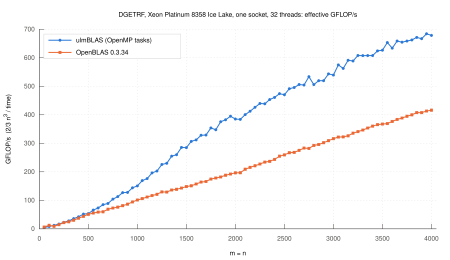

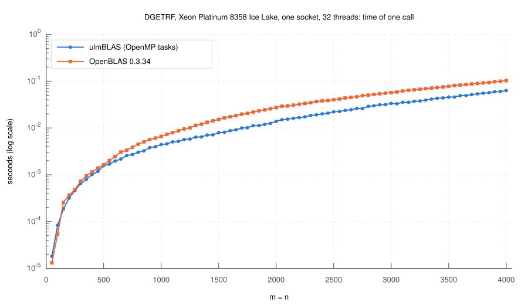

Speedup plots: 1 means exactly as fast as OpenBLAS, 2 means twice as fast.

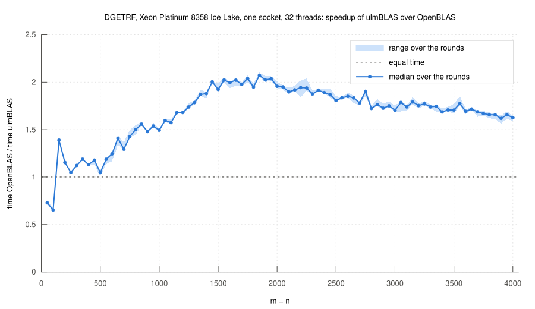

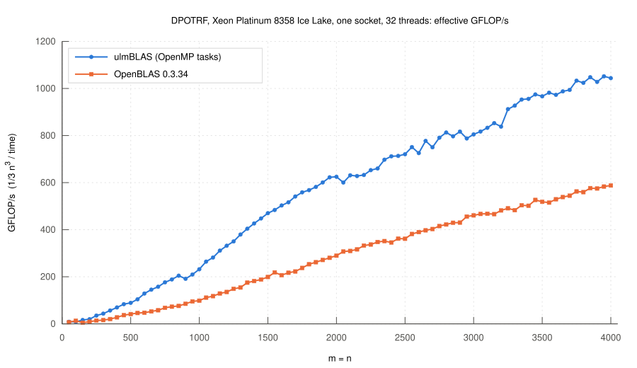

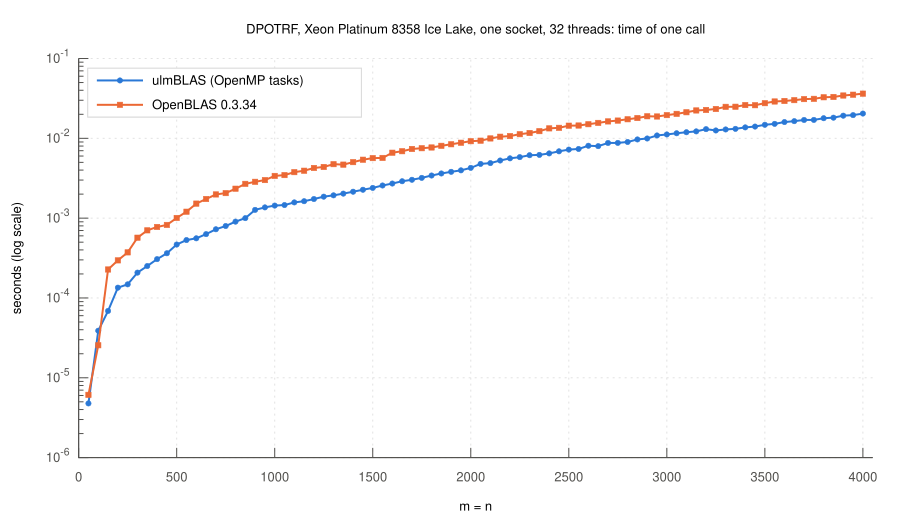

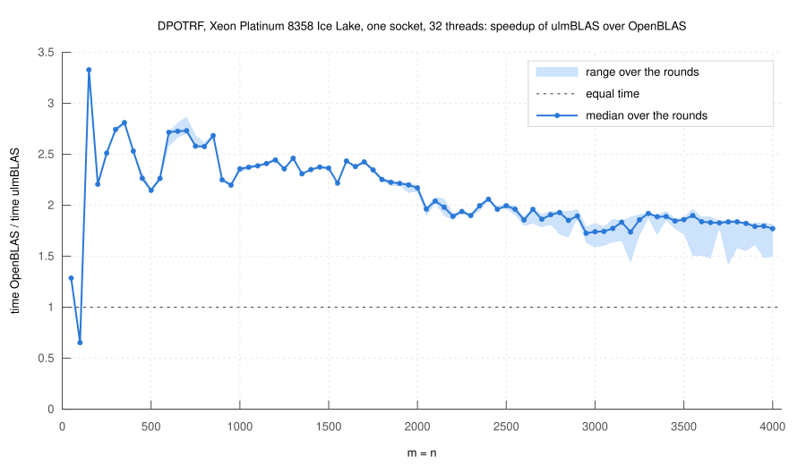

- `dgetrf` faster than OpenBLAS at 78 of 80 sizes.  Speedup 1.05-1.2 for
  n = 200-500, 1.5-2.1 for 1000-2500, 1.6-1.8 up to 4000.
- `dpotrf` faster at 79 of 80 sizes.  Speedup 2.1-3.3 for n = 150-1950,
  1.7-2.2 above.
- Why: no barrier between the steps.  OpenBLAS's `dgetrf`/`dpotrf` drivers
  are fork-join and synchronize after every step.
- Slower at n = 50, 100 (LU: 0.73, 0.65) and n = 100 (Cholesky: 0.65).
  Both libraries run on one core there.  ulmBLAS's small-matrix kernels are
  slower, and tasks don't help: 7-10 µs per call plus about 1-1.5 µs per
  task.
- n = 150: OpenBLAS switches to 2 threads too early (that's where the 3.3
  for Cholesky comes from).
- Large n, LU: one thread creating all tasks costs 36% of the time at n =
  2000.  Two instead of three dependencies per GEMM changed nothing, so
  it's task creation/queueing, not dependency bookkeeping.
- Cholesky at n >= 3000: ulmBLAS times vary from call to call (n = 4000:
  19.6-29.1 ms vs. 35.1-36.9 ms for OpenBLAS).  Even the slowest call beats
  OpenBLAS.
- 64 threads (two sockets) were slower than 32 for both libraries.

Numbers per size: [`summary-getrf.dat`](results/2026-11-06-icelake-32threads/summary-getrf.dat),
[`summary-potrf.dat`](results/2026-11-06-icelake-32threads/summary-potrf.dat).
Raw data and all samples: [`results/2026-11-06-icelake-32threads`](results/2026-11-06-icelake-32threads).
Tuning runs: [`results/tuning`](results/tuning).

## Strides and copies: Ice Lake

Same machine and settings as above, current code.  `incRow` R: the matrix
is every R-th row of a column-major matrix, `A(i,j) = A[i*R + j*R*n]`.
OpenBLAS always column-major (its LAPACK can't do anything else).

- Variants: in place (R = 1, 2, 42), `colmajor` copy (R = 1, 2, 42),
  `tiled` copy (R = 1, 2, 42, `dpotrf` only).
- Copies are part of the measured call.  The workspace is reused, so the
  timed calls (after 2 warm-up calls) don't pay for allocation.
- 3 rounds, one per job, order of the variants rotated.  Rounds ran on
  different nodes of the same type (uc2n601, 602, 603, 605, 607).
- Parameters (tile size, threads) are the column-major defaults, not
  tuned for strides.

In place, R = 1, 2, 42:

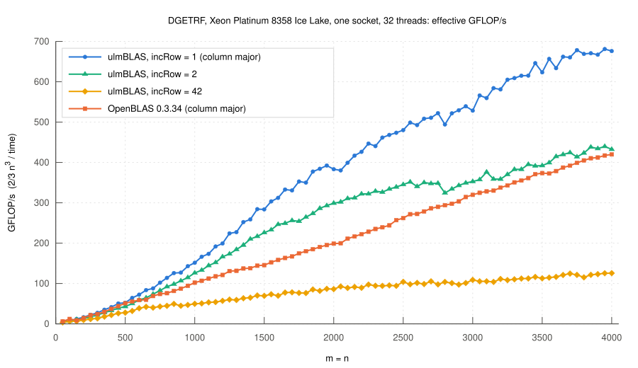

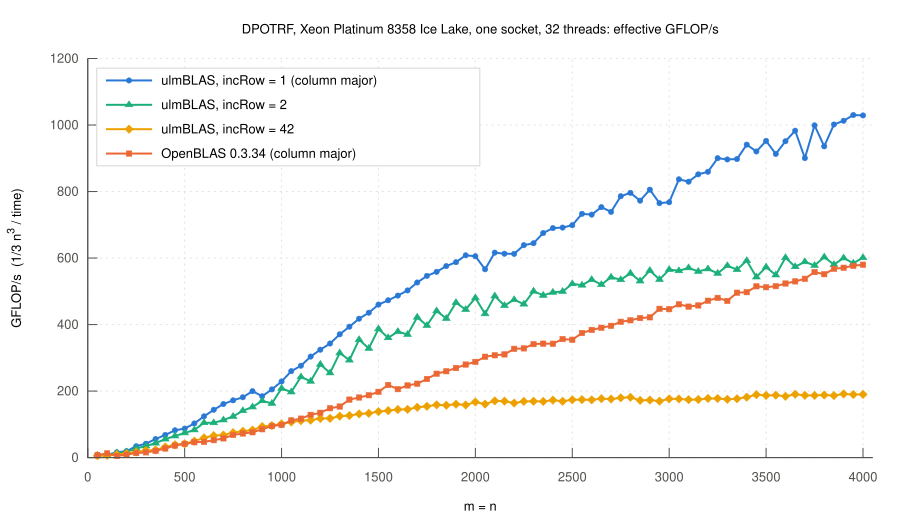

Speedup plots: 1 means exactly as fast as OpenBLAS (column-major).

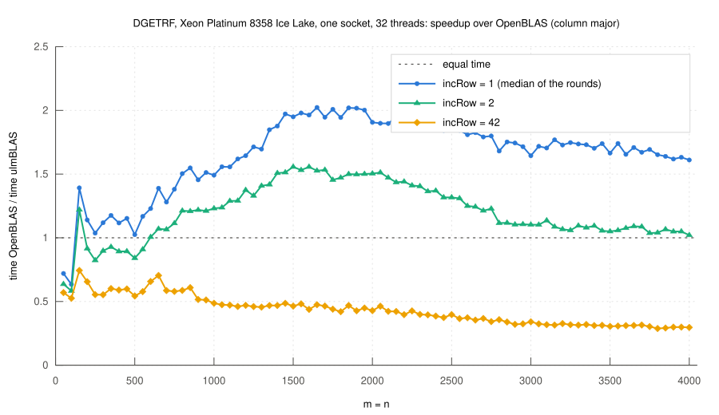

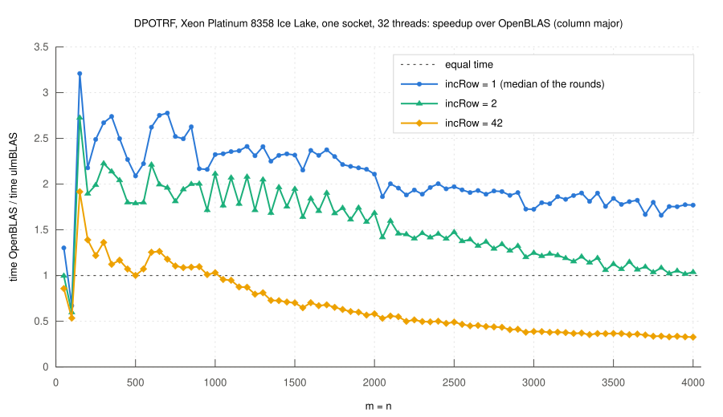

- R = 1 reproduces the first campaign (n = 4000: LU 676 vs. 678 GFLOP/s,
  Cholesky 1029 vs. 1044).
- R = 2: 0.7-0.9 of R = 1 up to n = 1000, about 0.6 at n = 4000 (LU 432,
  Cholesky 601).  Still faster than column-major OpenBLAS at 70 (LU) and
  78 (Cholesky) of 80 sizes; at n = 4000 about equal.
- R = 42: every element its own cache line.  LU 126, Cholesky 190
  GFLOP/s at n = 4000, 0.30 and 0.33 of OpenBLAS.  Not a layout to
  factor in place.

Copy first, or work in place?  1 means the copy variant is exactly as
fast as working in place with the same `incRow`; above 1 the copy pays
off.

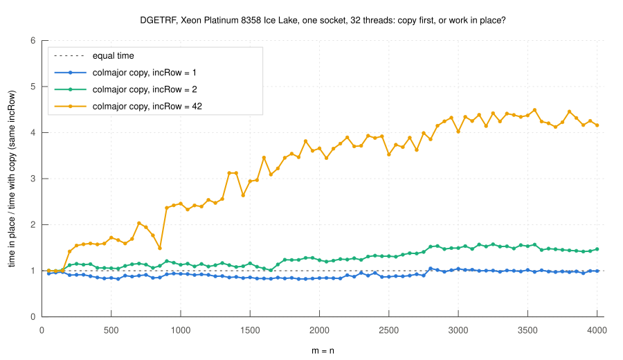

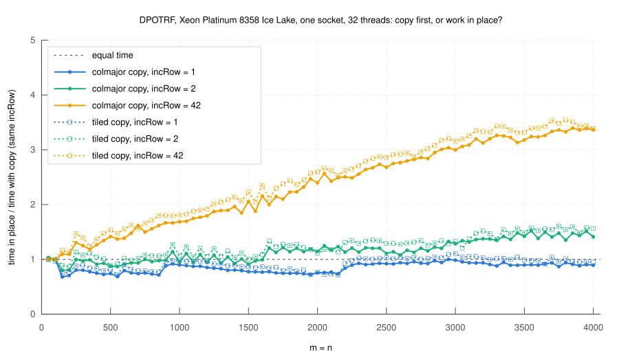

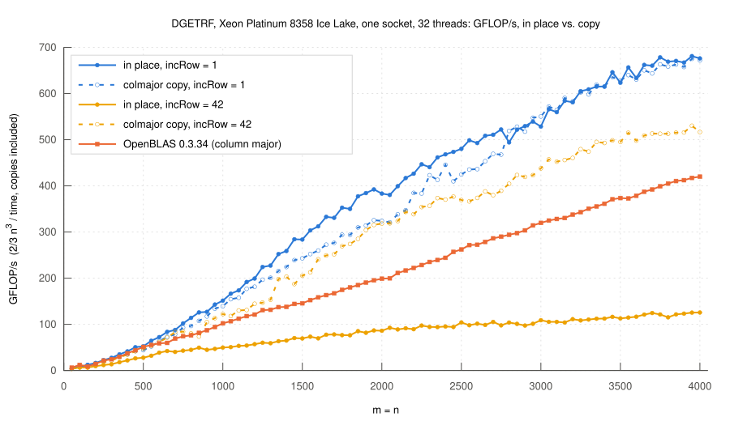

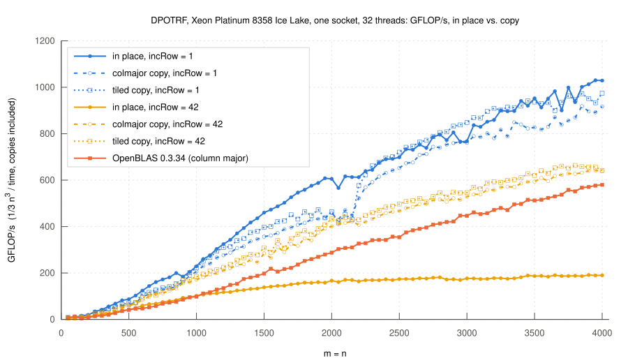

- R = 42: copying wins from n = 200 (LU) and n = 100 (Cholesky).  At
  n = 4000: 4.2x (LU, 517 GFLOP/s) and 3.4x (Cholesky, 639-642).
- R = 2: LU wins with a copy from n = 150 (1.0-1.3 up to n = 2000, 1.47 at
  4000).  Cholesky from n = 1650 (`colmajor`) or n = 700 (`tiled`), 1.4-1.6
  at 4000.
- R = 1: the copy costs, LU up to 18% (0.84 at n = 2000), Cholesky up to
  32% (0.76 at n = 2000).  The copy tasks overlap with the factorization,
  but not completely.
- Copying from R = 42 is expensive itself: the `colmajor` copy with R = 42
  reaches 0.7-0.8 of the same variant with R = 1 for n >= 3000 (0.8-1.0
  for smaller n).
- With the better of in place and copy per size, ulmBLAS with R = 2 or 42
  is faster than column-major OpenBLAS at 68-79 of 80 sizes (1.1-1.5x at
  n = 4000).
- `tiled` vs. `colmajor` copy (Cholesky, n >= 1000): tiled is faster by
  10% (R = 1), 9% (R = 2), 6% (R = 42), median over n.  But at R = 1 still
  slower than in place (0.77 at n = 2000, 0.95 at 4000).  PLASMA's layout
  alone doesn't buy much here: ulmBLAS's kernels pack their operands
  anyway.  Next: tiles already in the packed micro-panel format.
- Rule of thumb so far: R = 1 in place.  R = 2: in place for small and
  medium n, copy for large n (LU: copy almost always).  Large R: copy.

Data: [`results/2026-11-07-icelake-strides-variants`](results/2026-11-07-icelake-strides-variants)
(raw outputs, all samples, conditions; `summary-*-strides.dat`,
`summary-*-variants.dat` from `scripts/summarize-strides.py`).

## Large strides without a copy (Cholesky)

Question: a matrix with a big row stride, e.g. a slice of a tensor.  Can
we factor it without copying it first?

How much does the stride cost?  `n = 500 ... 4000`, `incRow = 1 ... 128`.
1 means exactly as fast as in place with `incRow = 1` (column-major);
0.5 means half as fast.

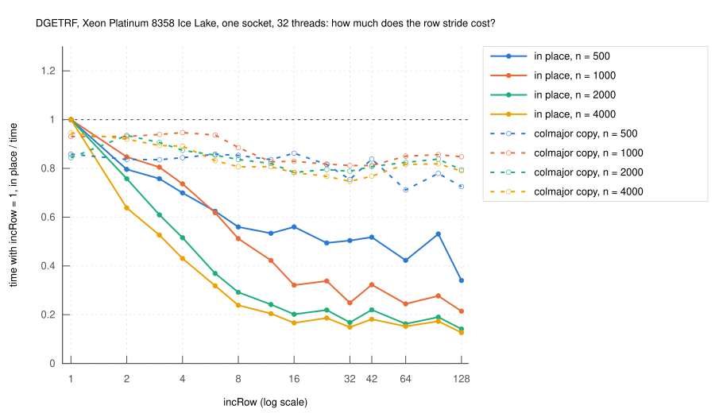

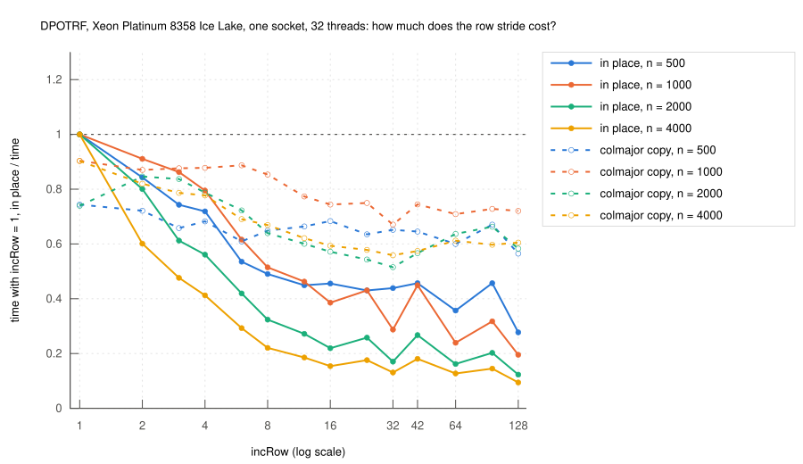

- In place: gets slower up to `incRow` 8-16 (then every element is its
  own cache line), then stays at about 0.15-0.2 of `incRow = 1` (n =
  4000; small n lose less).
- Powers of two (16, 32, 64, 128) are worse than their neighbours (cache
  sets).
- With a copy the stride hardly matters: LU about 0.8, Cholesky about 0.6
  of `incRow = 1` (n = 4000).

What I tried for `dpotrf` in place (all optional parameters):

- `prepack`: pack every tile of L once after its TRSM, the GEMMs call the
  macro kernel `mgemm` directly.  Helps only in place with a big stride
  (1.2x at `incRow = 42`), otherwise 3-5% slower.

1 means exactly as fast as without `prepack`; above 1 `prepack` helps.

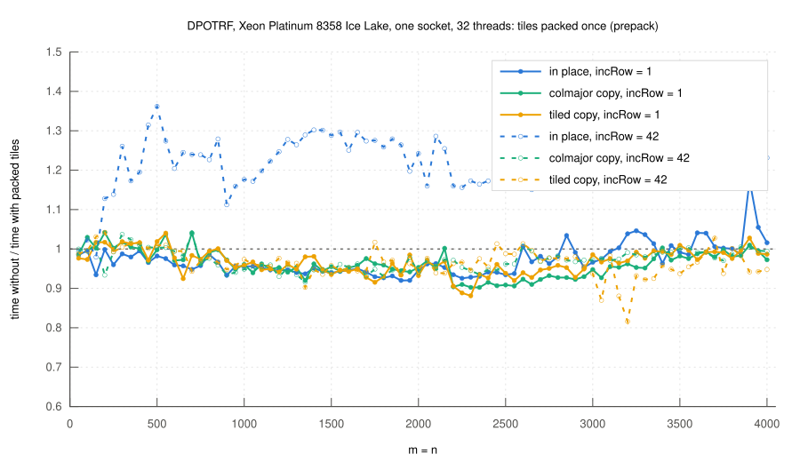

- `outer = s`: group s tile columns.  The rest of the matrix gets one
  update per group instead of one per tile column, so it is read and
  written s times less often.  s = 4 is best.
- `window = w`: update the rest of the matrix only every w groups.
- `strip = 1`: copy the tiles of the current group into a small buffer,
  factor them there, copy them back.
- Extra memory: packed tiles of w+1 groups (two formats) and the tiles of
  two groups for `strip`: `2 (w+2) n s nb` doubles.  It doesn't grow with
  the stride, but it is not small: with s = 4, nb = 128, w = 2 it is
  about the size of the matrix at n = 4000 (twice at n = 2000).  So for
  these sizes it saves no memory compared to a copy, only for larger n.
  To do: smaller buffers.

Results (GFLOP/s, Cholesky, Ice Lake, 32 threads, 3 rounds; in place
from the `outer` campaign, the rest from the window/strip campaign, same
code):

| | n = 2000, incRow 8 | 16 | 42 | 128 | n = 4000, incRow 8 | 16 | 42 | 128 |
|---|---:|---:|---:|---:|---:|---:|---:|---:|
| in place | 196 | 134 | 164 | 76 | 227 | 161 | 189 | 98 |
| outer 4 | 339 | 236 | 300 | 120 | 511 | 367 | 428 | 239 |
| outer 4 + strip | 424 | 353 | 369 | 294 | 592 | 512 | 509 | 430 |
| outer 4 + window 2 + strip | 423 | 361 | 375 | 316 | 633 | 560 | 565 | 494 |
| full copy (`colmajor`) | 392 | 375 | 358 | 398 | 669 | 618 | 591 | 626 |

- `outer` + `strip` (+ `window` for big n) is about as fast as a full copy
  for `incRow` 2-42: 0.9-1.1x.  For `incRow = 128` about 0.8x.
- `incRow = 1`: plain in place is still best.

Tensor slice: `X(i,:,:)` of an `n1 x n x n` tensor (column-major), i.e.
`incRow = n1`, `incCol = n1 n`:

| n1 | in place | outer 4 + strip | full copy |
|---:|---:|---:|---:|
| 16 | 133 | 355 | 362 |
| 64 | 100 | 335 | 405 |
| 256 | 70 | 300 | 404 |
| **1000** | 205 | **424** | 384 |
| 4096 | 40 | 172 | 274 |

(GFLOP/s, n = 2000.)

- `n1 = 1000`: 1.1x faster than the full copy, 2x faster than in place.
- `n1` a power of two (256, 4096): everybody is slower, the copy less.
  Here a copy is still the better choice.

Data: [stride sweep](results/2026-11-07-icelake-stride-sweep),
[prepack](results/2026-11-07-icelake-prepack),
[outer](results/2026-11-07-icelake-outer),
[window/strip](results/2026-11-07-icelake-window-strip),
[tensor slice](results/2026-11-07-icelake-tensor-slice)
(`scripts/summarize-sweep.py`, `cluster/sweep.sbatch`).

## Tests

- `make check`, `make check-full`: against OpenBLAS's `dgetrf_`/`dpotrf_`.
  - LU: random, `P0 L0 U0` with known pivots, zero columns, zero matrix,
    rectangular.  Checks `INFO`, pivots (= reference, = expected),
    `|L| <= 1`, residual, padding rows untouched.
  - Cholesky: SPD with condition 10, 1e6, 1e12; not positive definite at
    the start/middle/end.  Checks `INFO`, residual, other triangle and
    padding untouched (bitwise).
  - Several sizes and `ldA`, tile sizes 8-100, 1-32 threads, panel threads
    1-16.
  - Every test in 6 layouts: C interface, and C++ interface with
    column-major + padding, `incRow` 2, `incRow` 42, row-major, row-major
    with gaps (`(3n+1, 3)`).  The test matrix is copied into the strided
    array (gaps hold a marker) and back; same checks, plus gaps untouched.
  - The copy variants, prepack, outer, window and strip on top: 27
    combinations.
  - That found a bug in ulmBLAS itself: `ulmBLAS::ger` with neither stride
    1 did not load `A` into its packing buffer
    ([#0030](../test/known_issues.md), regression test `T0806`).  The C
    and Fortran interfaces never get there (always column- or row-major).
- `make check-deps`: every task logs its tiles and start/end time; any
  conflicting pair running in the wrong order or overlapping aborts.
- `make check-bounds`: no kernel writes outside its tile.
- `make check-neighbor`: no kernel loads and stores back a neighbor element
  (that would be a lost update in parallel).
- `make check-determinism`: bitwise identical results in every run
  (Cholesky; LU with serial panels, since team panels round differently).
- All checkers caught a planted bug.
- Ice Lake (GCC 14.2, libgomp), code of the benchmark below (column-major
  only): 330,471 checks, 0 failures.  Pivots identical to OpenBLAS on all
  random and `P0 L0 U0` matrices.
- Ice Lake, current code (strides, variants, prepack, outer, window,
  strip): 2 x 789,135 checks (1 and 32 threads), dependency checker
  570,255, 11,215 determinism runs, bounds and neighbor tests: 0 failures.

## macOS: libomp ordering bug (found, worked around)

Apple M5, Apple clang, Homebrew `libomp` 23.1.4.  With tiny 8 x 8 tiles
we got rare wrong results: a `dpotrf` with `INFO > 0` for an SPD matrix,
an LU with a huge residual, differences in the determinism test (1 in
10,000 to 1 in 400 calls, depending on the day).  Never on Ice Lake.

What a wrong result looks like (Cholesky):

- Same input, recomputing gives the right result again.
- One column of the L tiles below a diagonal tile is off by a factor
  `L(j,j)`.  The TRSMs used `L(j,j)^2` instead of `L(j,j)`: the value
  before the square root.  POTRF had finished, and the diagonal tile is
  correct at the end.
- Exactly one 8-element column = one cache line was stale.  Looks like
  memory ordering, not like a missing dependency.

Cause (libomp 23.1.4 source):

- Creating a task with dependencies, libomp checks each predecessor
  without a lock: `if (node->dn.task)` in `__kmp_process_dep_list` /
  `__kmp_depnode_link_successor` (`kmp_taskdeps.cpp`).  NULL means
  "finished", no edge is added, the new task can run right away.
- The finishing thread writes that NULL with a plain store in
  `__kmp_release_deps` (`kmp_taskdeps.h`).  Between the task body and
  this store there is no release (taking the ticket lock is only an
  acquire).
- On AArch64 the NULL can be visible before the task body's stores.  The
  successor then reads stale data.  x86 (TSO) keeps stores in order.
- So it only hits when a task is created right when its predecessor
  finishes.  Tiny tiles make that frequent.  Larger tiles make it rare,
  not impossible.

Workaround in [`src/common.h`](src/common.h): every task body starts with
an acquire fence and ends with a release fence (`taskEnter()`,
`taskLeave()`).  On x86 these generate no code (`getrf.o` identical,
`potrf.o` only register renaming), so the Ice Lake numbers still apply.

Evidence, `nb = 8`, n = 400, 3-4 threads, OpenBLAS calls in between:

| | calls | wrong |
|---|---:|---:|
| without fences | 18,785 | 46 |
| with fences | 19,333 | 0 |

Without ulmBLAS: [`test/libomp_fastpath.cc`](test/libomp_fastpath.cc),
one task writes 64 ints, a second one with `depend(in)` checks them, and
the second is created at about the time the first finishes.  16M pairs:
21 and 12 errors in two runs, almost all when the producer had already
finished at creation (lock-free path).  With a release fence at the end
of the producer: 0.

Same with the final code (`taskEnter`/`taskLeave`), alternating with the
old build: 0 in 13,110 calls (old: 26 in 13,284).  Determinism test (all
sizes, tiles 8/16/33): 0 in 18,851.  `make check-full`, `check-deps`,
`check-bounds`, `check-neighbor` pass on the M5.

Ruled out along the way:

- Dependency order of our task graph (checker), kernels touching
  neighbor elements, state left behind by OpenBLAS.
- The LU panel team: half of the failures were Cholesky (no panel), all
  had `panel_threads = 1`.  Separate run with forced teams of 2 and 4 and
  dynamic teams: 0 differences (but that run didn't show the bug at all).
- [llvm#226798](https://github.com/llvm/llvm-project/issues/226798)
  (priority queue, barrier left too early) and
  [llvm#226812](https://github.com/llvm/llvm-project/issues/226812)
  (dependency hash freed twice): both real, both reproduced with
  [`test/libomp_pattern.c`](test/libomp_pattern.c) when tasks are created
  under `omp master` (crashes, hangs).  Not our problem: we use
  `omp single`, and their workarounds (`OMP_MAX_TASK_PRIORITY=0`; tasks
  inside `task if(0)` + `taskwait`) did not remove our wrong results
  (17 in 44,161 and 4 in 45,359 calls, vs. 10 in 48,560 without).

Not reported to LLVM yet.

## Reproduce

On bwUniCluster (settings in [`cluster/env.sh`](cluster/env.sh)):

```sh
sbatch cluster/build-openblas.sbatch
sbatch -p dev_cpu_il cluster/test.sbatch SRC
sbatch -p dev_cpu_il cluster/bench.sbatch SRC OUT getrf "1 2 3 4 5"   # and potrf
scripts/summarize.py OUT
gnuplot -e "R='getrf'; NAME='DGETRF'; D='OUT'; O='plots'" scripts/plot.gp

# strides and copy variants (one job per round fits into 30 minutes)
V="1 2 42 1/colmajor 2/colmajor 42/colmajor 1/tiled 2/tiled 42/tiled"
sbatch -p dev_cpu_il cluster/bench.sbatch SRC OUT getrf "1" "$V"      # rounds 1, 2, 3; potrf
scripts/summarize-strides.py OUT
gnuplot -e "R='getrf'; NAME='DGETRF'; D='OUT'; O='plots'" scripts/plot-strides.gp   # and plot-variants.gp
```

`SRC` is an unpacked `git archive` of the repository.  Tuning stages:
[`cluster/tune.sbatch`](cluster/tune.sbatch).

## Files

- [`include/ulmlapack.h`](include/ulmlapack.h): C interface
- [`include/ulmlapack.hpp`](include/ulmlapack.hpp): C++ interface (strides,
  copy variants, `TileMatrix`)
- [`src/potrf.cc`](src/potrf.cc), [`src/getrf.cc`](src/getrf.cc): task
  graphs, panel team, default parameters
- [`src/kernels.h`](src/kernels.h): serial kernels
- [`src/common.h`](src/common.h): spin barrier, task fences (libomp workaround)
- [`src/tiles.h`](src/tiles.h): tile addressing (strided or tiled), copies
- [`src/checkdeps.h`](src/checkdeps.h): dependency checker, profiling
- [`test/`](test): tests
- [`bench/bench.cc`](bench/bench.cc): benchmark (ulmBLAS or OpenBLAS)
- [`cluster/`](cluster): Slurm jobs
- [`scripts/`](scripts): summary, plots
- [`results/`](results), [`plots/`](plots): data and figures
